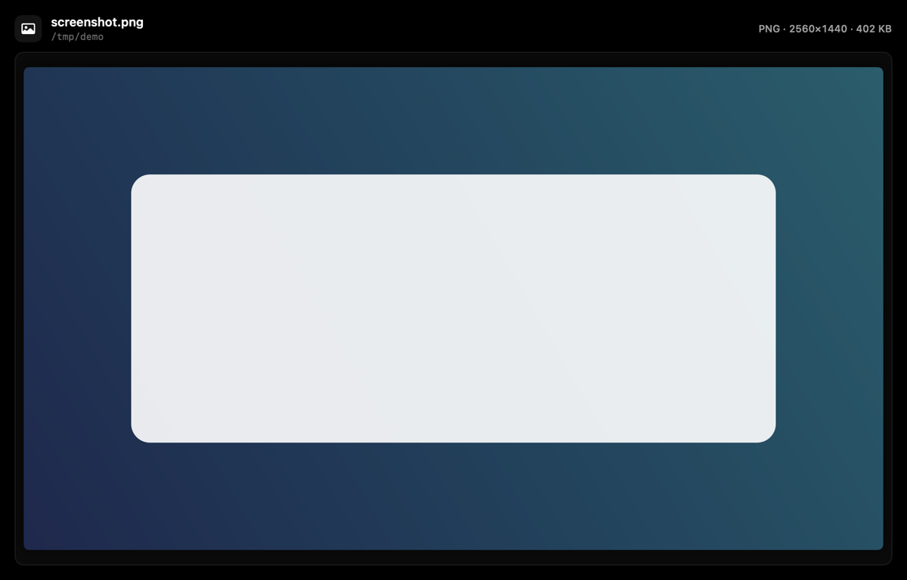
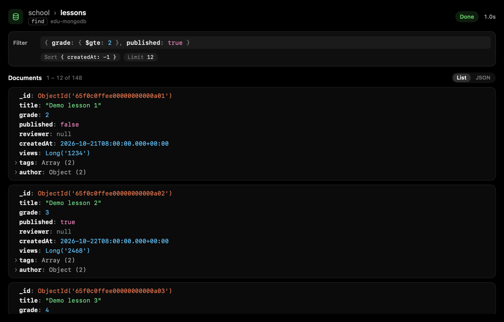
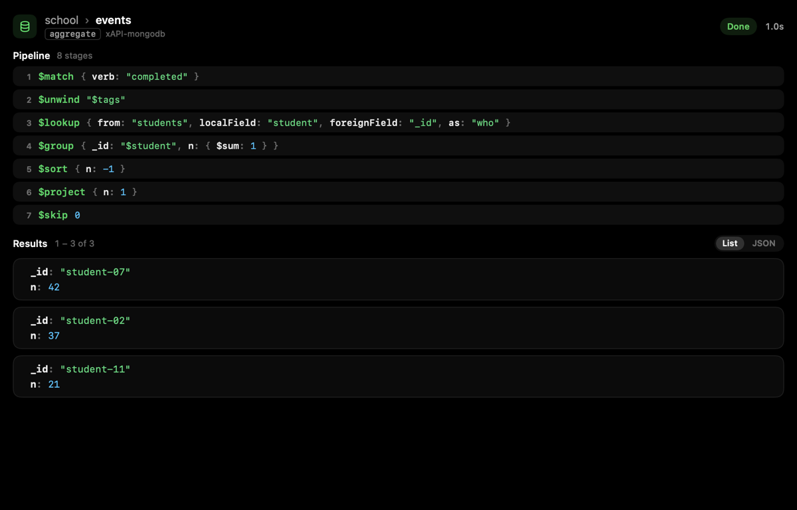
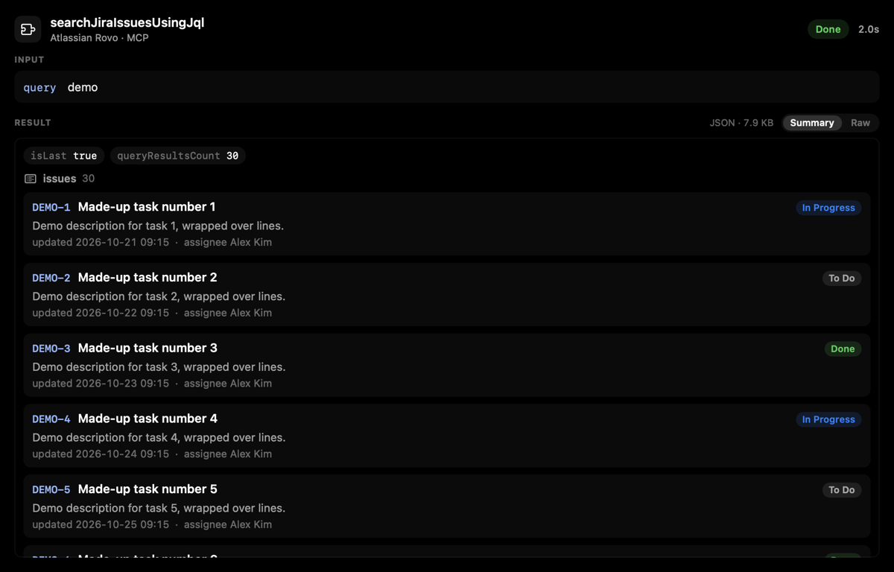
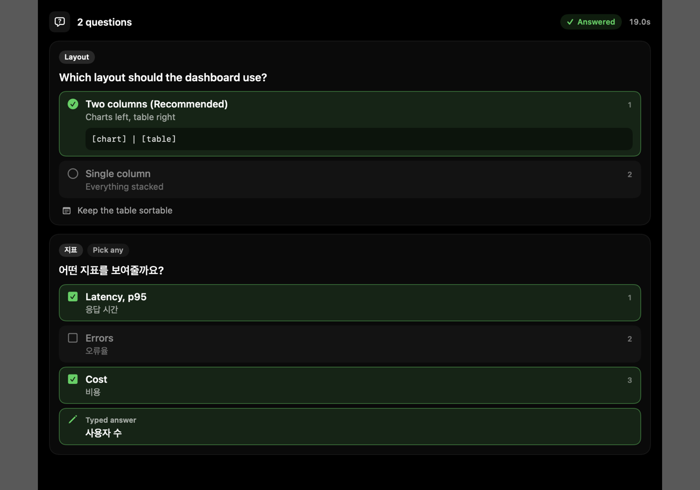
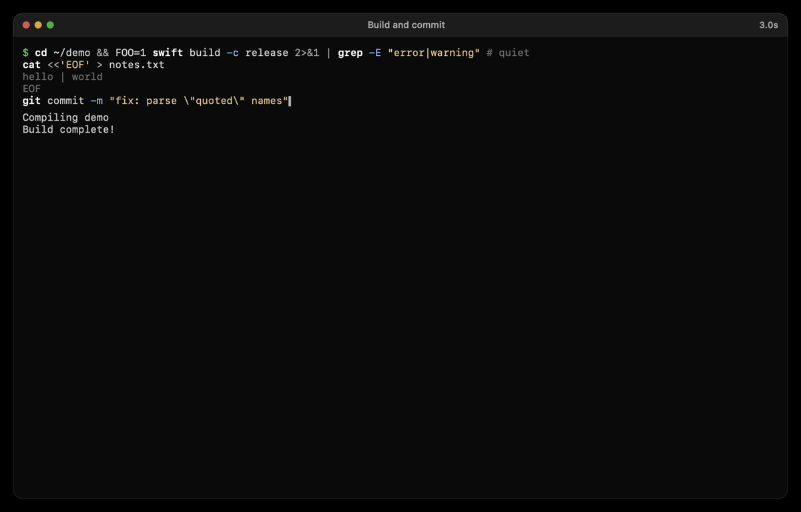
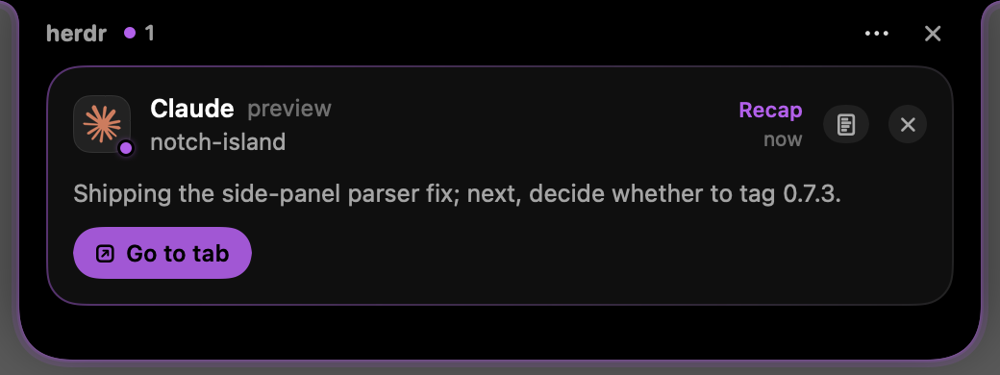

# Changelog

All notable changes to Herdr Island. Versions follow `herdr-plugin.toml`; each has a matching
[GitHub release](https://github.com/speardragon/herdr-island/releases). Screenshots use made-up demo data.

## 0.7.8 — 2026-10-29

### Added
- **Pictures on the live stage.** When an agent reads an image, the stage shows the picture itself with its format, dimensions and file size, drawn from the file on disk (the transcript keeps no copy). Reads of `.png`, `.jpg`, `.gif`, `.webp`, `.heic` and similar open in this view from the first frame.
- **MongoDB calls like a database viewer.** MongoDB MCP tools (any server whose name contains `mongo`) show `database › collection`, the filter and options or the aggregation pipeline in mongosh style, and documents as cards of typed fields: ObjectId, dates, numbers, strings and booleans each in their own colour (MongoDB Compass dark), nested objects and arrays folded until opened. Counts get a stat card and `list-collections` / `list-databases` a name grid. Switch between List and JSON.

### Changed
- Documents keep the field order the database wrote (`_id` first).
- MongoDB results are kept up to 300,000 characters instead of 20,000; a result cut short still shows its complete documents and says the rest was cut.

## 0.7.7 — 2026-10-28

### Fixed
- Questions whose options carry a **preview** (Claude draws a box beside the list) are read again: the box is cut off, labels that wrap in the narrow column are joined, and the unnumbered "Chat about this" row and the notes hint no longer hide the options.
- A permission prompt whose option wraps onto a second line is read correctly.

## 0.7.6 — 2026-10-26

### Added
- **MCP results are summarized.** Large JSON results show as records (a key, title, status, one line of detail and a few facts, such as Jira issues or calendar events) or as an object's fields, instead of pages of raw JSON. Raw text stays one click away. This also fixes the lag on very large results.

### Fixed
- A long question wrapped over several lines of its quote box is read as one question, not a title plus a question.

## 0.7.5 — 2026-10-26

### Added
- **AskUserQuestion on the live stage.** Each question with its options and descriptions; once answered, the picks light up (multi-select included) along with typed answers and notes. Declined and still-waiting questions are shown as such.
- **MCP tools** get their own stage: the server and tool, the arguments as key/value rows, and the result with light JSON highlighting. Image results are counted.
- **Shell commands are highlighted**: commands, flags, strings, operators, comments and heredocs.

## 0.7.4 — 2026-10-25

### Added
- **Recap.** When Claude finishes with only an "away summary", the agent is marked **Recap** in its own colour (purple by default, `glow.recap_color`) and the card shows the summary. It follows the done alerts and sounds.

## 0.7.3 — 2026-10-23

### Fixed
- Prompts are read when the Claude UI has a side panel (an explorer or changes view) drawn beside it.

## 0.7.2 — 2026-10-23

The first release. See the [release notes](https://github.com/speardragon/herdr-island/releases/tag/v0.7.2).
