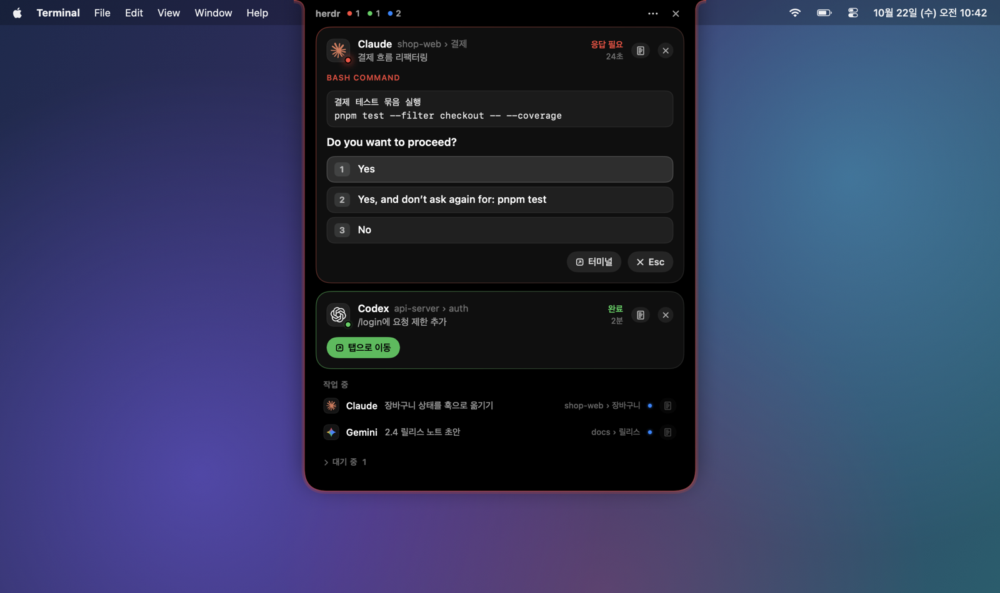

<div align="center">

[English](README.md) · **한국어**

# Herdr Island

**herdr 에이전트가 MacBook 노치에 삽니다.**

승인 요청이나 질문에 바로 답하고, 끝난 작업으로 바로 이동하고, 지금 무엇을 하고 있는지 실시간으로 지켜보세요.
터미널을 오가지 않아도 됩니다.




</div>

---

## 왜 Herdr Island인가요?

[herdr](https://herdr.dev)로 에이전트 여러 개를 돌리다 보면 하루에도 수십 번 같은 일을 하게 됩니다.
어느 탭에서 승인을 기다리는지 찾고, 그 터미널로 가서 `1`을 누르고, 하던 일로 돌아옵니다.

Herdr Island는 그 일을 노치로 옮깁니다. 에이전트가 응답을 기다리거나 작업을 끝내면 노치가
Dynamic Island처럼 펼쳐지고, 그 자리에서 바로 답할 수 있어요. 노치가 없는 Mac에서는 메뉴 막대에서 같은 화면이 열립니다.

## 주요 기능

### 승인과 질문에 바로 답하기

- **승인 요청**: 실행하려는 명령과 선택지(`Yes` / `Yes, and don't ask again…` / `No`)가 그대로 보이고, 누르면 그 답이 에이전트에 전달됩니다.
- **질문(AskUserQuestion)**: 질문 탭, 선택지와 설명, 다중 선택 체크박스, 직접 입력, "대화로 답하기"를 지원합니다. 질문이 여러 개면 다음 질문으로 자연스럽게 이어져요.
- **완료**: **탭으로 이동**을 누르면 해당 herdr pane으로 포커스가 옮겨지고 터미널 앱이 앞으로 나옵니다.
- 터미널에서 직접 답해도 섬이 화면을 다시 읽어 다음 단계를 따라갑니다.

<p align="center">
  
</p>

### 접혀 있어도 알 수 있게


접힌 노치 양옆에 대표 에이전트의 로고와 상태 점이 보입니다. 응답이 필요하면 섬 가장자리가 **빨갛게**,
완료된 작업이 있으면 **초록색**으로 은은하게 숨쉬듯 빛나요. 새 알림이 오면 잠시 저절로 펼쳐지고,
노치에 마우스를 올리거나 클릭하면 언제든 열 수 있습니다.

### 세션 상세: 토큰, 캐시, 도구, 파일

<table>
<tr>
<td width="44%"></td>
<td>

에이전트 옆의 상세 버튼을 누르면 섬이 옆으로 넓어지면서 그 세션의 상세가 열립니다.

- **토큰**: 합계와 구성(캐시 읽기·캐시 쓰기·입력·출력)
- **캐시 히트율**과 **컨텍스트 크기**
- **작업 시간**, 턴 수, 세션 길이
- **활동**: 도구 호출을 최신순으로 보여주고, 펼치면 입력과 결과(얻은 정보)가 나옵니다
- **파일**: 수정한 파일의 +/− 줄 수와 diff, 읽은 파일

</td>
</tr>
</table>

### 실시간 무대: 지금 무엇을 하고 있는지


작업 중인 에이전트는 상세를 열면 **실시간** 화면이 먼저 보입니다. 지금 실행 중인 단계를 도구에 맞는 화면으로
크게 보여주고, **크게 보기**를 누르면 섬이 화면 크기에 맞게 커져요.

<table>
<tr>
<td width="50%"></td>
<td width="50%"></td>
</tr>
</table>

| 도구 | 보여주는 방식 |
| --- | --- |
| **Read** | 파일 전체를 띄우고 읽은 줄을 강조한 뒤 그 위치로 스크롤합니다. `.md`는 문서로 렌더링해요. |
| **Write** | 편집기에 내용이 타이핑되듯 입력됩니다. |
| **Edit** | 실제 줄 번호가 붙은 diff. 새 줄이 타이핑됩니다. |
| **Bash** | 터미널 창: 명령, 경과 시간, 출력, 실패 표시 |
| **Grep / Glob** | 검색창과 결과 목록(일치 부분 강조) |
| **WebFetch / WebSearch** | 브라우저 창: 주소창, 로딩 막대, 결과 |
| **Task** | 서브에이전트 카드와 진행 중인 하위 단계 |
| **TodoWrite** | 체크리스트와 진행 막대 |
| **Skill** | 스킬 배지 |

### 노치가 없어도: 메뉴 막대 모드


외장 모니터나 노치가 없는 Mac에서는 메뉴 막대 아이콘에서 같은 패널이 열립니다.
노치와 메뉴 막대를 함께 쓰거나, 모든 화면에 노치 섬을 띄울 수도 있어요.

### macOS다운 설정

<table>
<tr>
<td width="46%"></td>
<td>

일반 macOS 앱처럼 설정 창에서 바꾸고, 바꾼 값은 바로 적용되어 `config.toml`에 저장됩니다.

- **표시 위치**: 노치, 메뉴 막대, 둘 다, 띄울 화면
- **메뉴 막대 패널**: 띄울 화면과 위치
- **알림**: 저절로 펼칠지, 얼마나 열어 둘지, 소리
- **가장자리 빛**: 켜기·끄기, 색, 세기
- **투명도**: 마우스가 없을 때 투명하게
- **닫기**: 마우스가 벗어날 때, 바깥 클릭, 처리할 에이전트가 없을 때
- **언어**: 한국어 / English

</td>
</tr>
</table>

---

## 설치

**필요한 것**: macOS 13 이상 · [herdr](https://herdr.dev) 0.9.0 이상 · Xcode Command Line Tools(`xcode-select --install`)

```sh
herdr plugin install speardragon/herdr-island
```

소스에서 바로 쓰려면 저장소를 받은 뒤 로컬 플러그인으로 연결하세요.

```sh
git clone https://github.com/speardragon/herdr-island.git
herdr plugin link ./herdr-island
```

설치할 때 Swift 헬퍼를 빌드하고, 다음 에이전트 이벤트부터 자동으로 실행됩니다. 따로 실행할 것은 없어요.

## 사용법

| 하고 싶은 일 | 방법 |
| --- | --- |
| 섬 열기 | 노치에 마우스를 올리거나 클릭. 메뉴 막대 모드는 아이콘 클릭 |
| 승인·질문에 답하기 | 카드에서 선택지를 누르거나 직접 입력 후 Enter |
| 끝난 작업으로 가기 | 완료 카드의 **탭으로 이동** |
| 세션 상세 보기 | 카드·목록 오른쪽의 상세 버튼 |
| 실시간 무대 크게 보기 | 상세 위쪽의 **크게 보기**(↗) |
| 숨기기 | 카드의 ✕(상태가 바뀔 때까지 숨김), 섬 오른쪽 위 ✕(닫기) |

### 단축키

herdr `config.toml`에 액션을 연결하면 키 하나로 열고 닫을 수 있습니다.

```toml
[[keys.command]]
key = "prefix+i"
type = "plugin_action"
command = "speardragon.herdr-island.toggle"
description = "Herdr Island"
```

| 액션 | 하는 일 |
| --- | --- |
| `toggle` / `open` / `close` | 섬 열기·닫기 |
| `settings` | 설정 창 열기 |
| `mode-notch` / `mode-menubar` / `mode-both` / `cycle-mode` | 표시 위치 바꾸기 |
| `reload` | `config.toml` 다시 읽기 |
| `quit` | 종료(다음 에이전트 이벤트에서 다시 실행) |

```sh
herdr plugin action invoke speardragon.herdr-island.toggle
```

## 설정

설정 창(섬의 `⋯` → **설정…**)에서 바꾸는 것을 권장합니다. 파일을 직접 고쳐도 돼요.
위치는 `~/.config/herdr/plugins/config/speardragon.herdr-island/config.toml`입니다.

<details>
<summary><b>config.toml 전체 항목</b></summary>

```toml
[display]
mode = "auto"              # auto | notch | menubar | both
screen = "notch"           # 노치를 띄울 화면: notch | main | mouse | all
hover_to_expand = true     # 노치에 마우스를 올리면 펼치기(클릭은 항상 가능)
show_working = true        # 작업 중인 에이전트 목록 보기
language = "system"        # system | en | ko
fade_when_idle = true      # 마우스가 없으면 투명하게
fade_after_seconds = 5
fade_opacity = 0.35        # 0.1 ~ 0.9

[menubar]
screen = "icon"            # icon(아이콘을 누른 화면) | main | mouse | all
position = "icon"          # icon(아이콘 아래) | right(오른쪽 위) | center(가운데 위)

[behavior]
expand_on_blocked = true   # 응답이 필요하면 저절로 펼치기
blocked_auto_close = true  # false면 저절로 닫지 않음
blocked_peek_seconds = 9
expand_on_done = true
done_auto_close = true
done_peek_seconds = 6
close_on_leave = true      # 마우스가 벗어나면 닫기
leave_delay_seconds = 0.5
close_on_click_outside = true
close_when_clear = true    # 처리할 에이전트가 없으면(저절로 열린 경우) 닫기
blocked_sound = "none"     # "none" 또는 macOS 알림음 이름(Glass, Ping, Pop …)
done_sound = "none"

[glow]
enabled = true             # 가장자리 빛
blocked_color = "FF453A"
done_color = "30D158"
intensity = 0.6            # 0.1 ~ 1
```

파일을 고친 뒤에는 `reload` 액션을 실행하세요.

</details>

## 지원하는 에이전트

| 에이전트 | 상태·알림 | 승인·질문 답하기 | 세션 상세·실시간 |
| --- | :---: | :---: | :---: |
| Claude Code | ✅ | ✅ | ✅ |
| Codex | ✅ | 부분 지원(승인 프롬프트) | ✅ (같은 폴더의 최근 세션으로 추정, 파일 추적은 `apply_patch`만) |
| Gemini, Cursor, Copilot, OpenCode 등 herdr가 감지하는 에이전트 | ✅ | 터미널로 이동 | — |

## 동작 방식

```
herdr ──(소켓 events.subscribe)──▶ herdr-island 데몬 (Swift · AppKit + SwiftUI)
  ▲                                   │  blocked 화면 → 선택지 파싱
  └── agent.send_keys / send_text ◀───┘  버튼 → 키 입력
      agent.focus + 터미널 앱 활성화
                                      세션 기록(JSONL) ──▶ 상세 · 실시간 무대
```

- 이벤트마다 스크립트를 새로 띄우지 않고, 상주 데몬 하나가 herdr 소켓 구독을 유지합니다. 플러그인 훅은 데몬이 떠 있는지만 확인해요.
- 섬은 포커스를 가져가지 않는 투명 패널입니다. 그려진 섬 위에서만 클릭을 받고, 나머지 영역의 클릭은 아래 창으로 통과합니다.
- 버튼을 누르는 순간 터미널 화면을 다시 읽어서 커서 위치에 맞는 키를 보냅니다. 그래서 직접 입력 칸에 커서가 있어도 정확히 전달돼요.
- 세션 상세는 상세가 열려 있는 동안만, 기록 파일에 새로 추가된 부분만 읽습니다.

### 개인정보

모든 처리는 Mac 안에서만 이뤄집니다. Herdr Island는 herdr 소켓과 에이전트가 이미 남기는 로컬 기록 파일
(`~/.claude/projects`, `~/.codex/sessions`)만 읽고, 네트워크로 아무것도 보내지 않습니다.

## 자주 묻는 질문

<details>
<summary><b>"실시간"이 정말 실시간인가요?</b></summary>

에이전트는 도구 호출 하나가 끝난 뒤에 기록 파일에 씁니다. 그래서 0.5~1초 늦게 따라가고,
쓰기·수정의 타이핑은 완성된 내용을 1.8초 안에 재생하는 연출입니다. 결과(출력, 읽은 내용)는 도구가 끝나야 들어와요.

</details>

<details>
<summary><b>선택지 대신 "이 질문은 읽지 못했어요"가 보여요.</b></summary>

처음 보는 프롬프트 형식일 수 있습니다. 카드에 터미널 화면 끝부분이 함께 보이니 거기서 확인할 수 있고,
**다시 읽기**로 다시 시도할 수 있어요. 그 화면은 `~/.local/state/herdr-island/unparsed-<pane>.txt`에 저장되니
이슈에 첨부해 주시면 형식을 추가하겠습니다.

</details>

<details>
<summary><b>CPU를 얼마나 쓰나요?</b></summary>

평소에는 거의 쓰지 않습니다. 응답 필요·완료 에이전트가 있는 동안에는 가장자리 빛 애니메이션 때문에 몇 % 정도 쓰고,
실시간 무대를 크게 띄워 둔 동안에는 더 씁니다. 가장자리 빛은 설정에서 끌 수 있어요.

</details>

<details>
<summary><b>모든 화면에 띄웠을 때 하나를 닫으면요?</b></summary>

전부 함께 닫힙니다. 노치와 메뉴 막대를 같이 쓸 때도 같아요.

</details>

## 개발

```sh
swiftc -O src/*.swift -o bin/herdr-island     # 빌드
./tests/run.sh                                # 테스트(파서, 설정, 세션 기록, 실시간 로직)
./bin/herdr-island --demo docs/images/ko ko   # README 스크린샷(가상 데이터)
./bin/herdr-island --snapshot /tmp/island ko  # 실제 상태로 모든 화면을 PNG로
./bin/herdr-island dump                       # 창 상태와 blocked 화면 기록
./bin/herdr-island quit; sleep 1; ./bin/ensure-running.sh   # 다시 빌드한 뒤 재시작
```

데몬 로그는 `~/.local/state/herdr-island/daemon.log`에 남습니다.

## 크레딧

- 플러그인 구조와 터미널 활성화 로직은 [herdr-glow](https://github.com/DevooKim/herdr-glow)(MIT)를 참고했습니다.
- 프로바이더 로고: [LobeHub Icons](https://github.com/lobehub/lobe-icons)(MIT). 각 로고의 상표권은 해당 회사에 있습니다.
- 스크린샷의 에이전트, 프로젝트, 파일은 모두 가상의 데모 데이터입니다.

## 라이선스

[MIT](LICENSE)
