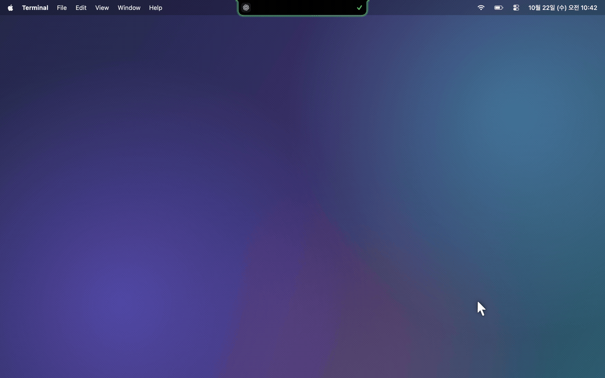
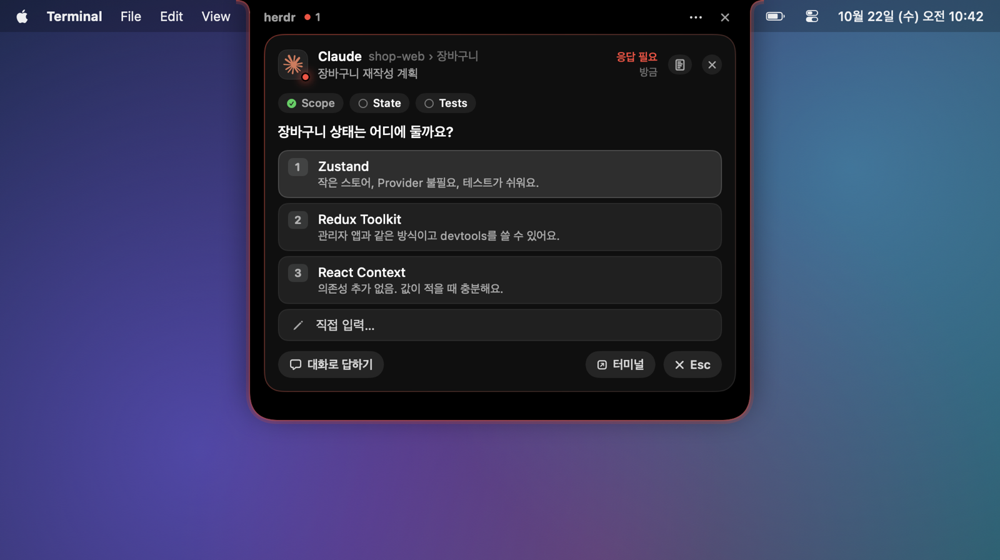
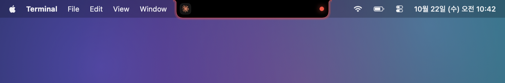
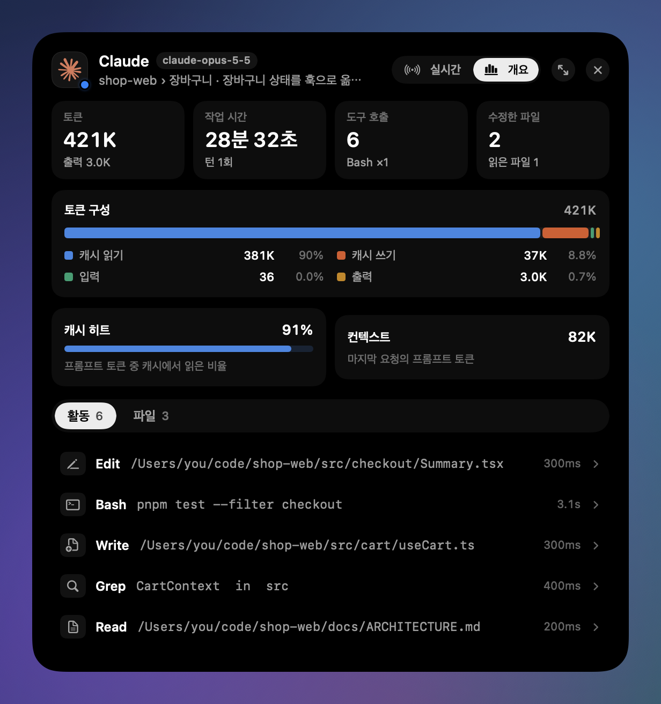
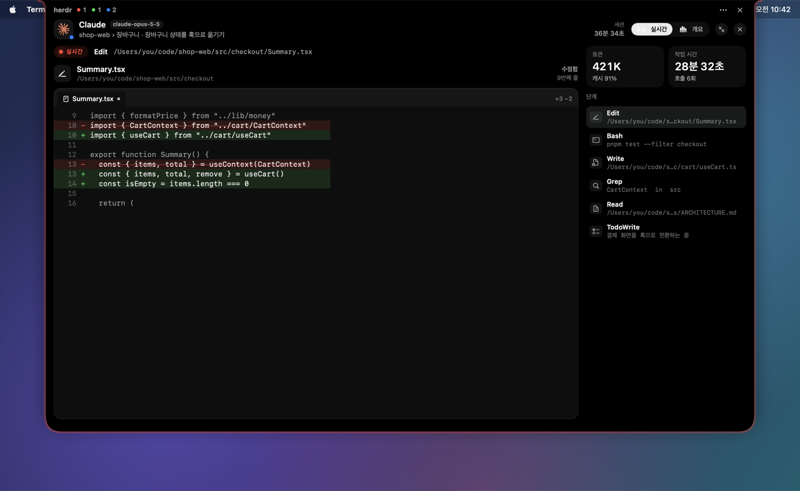
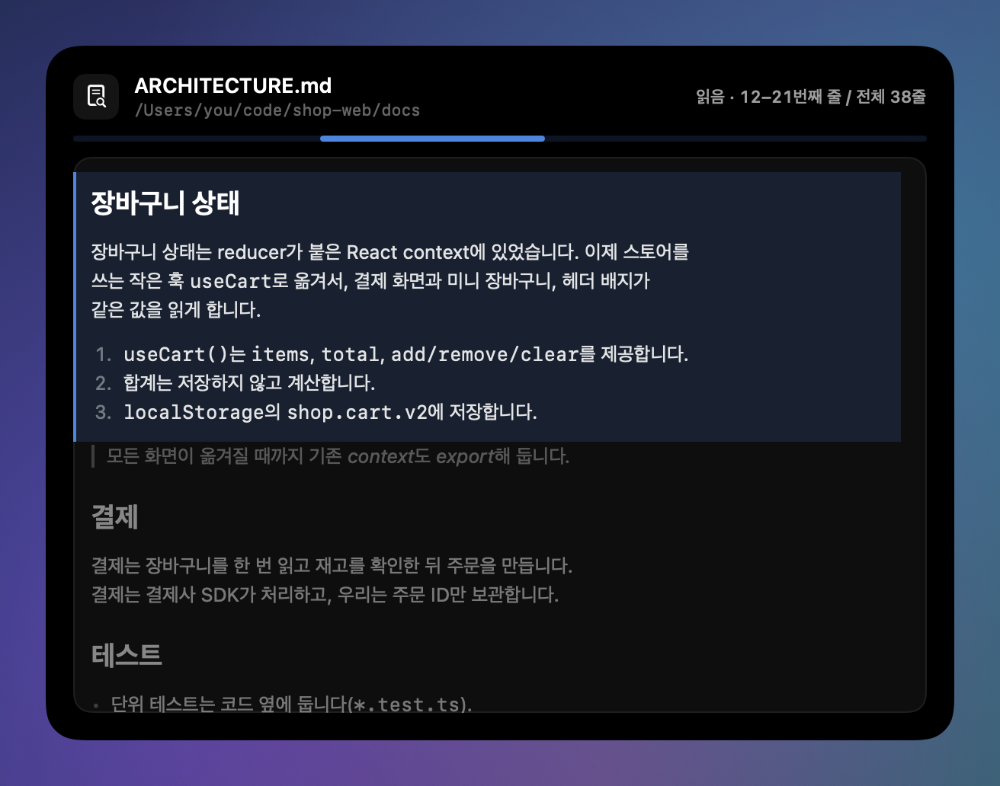
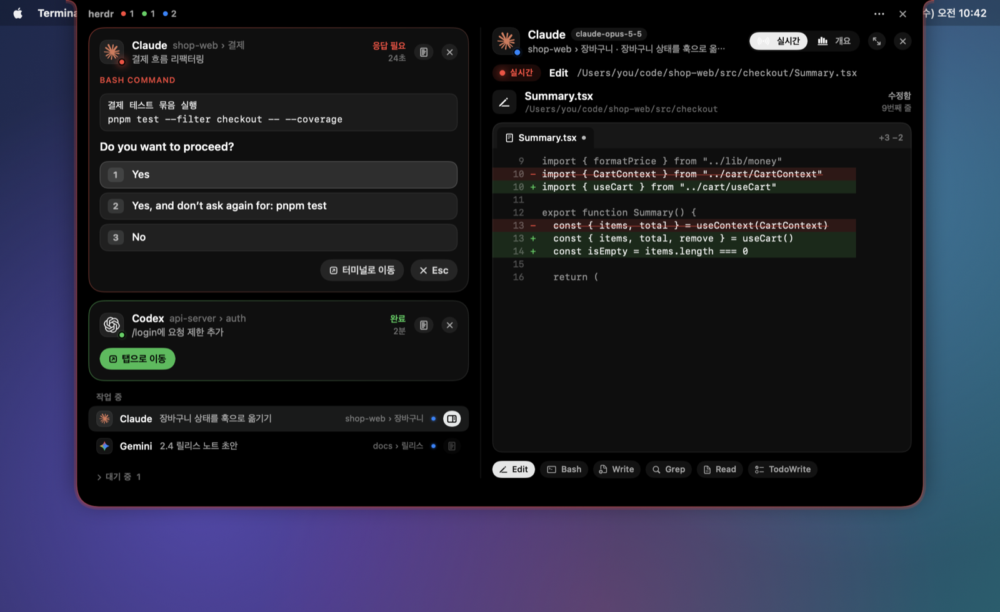
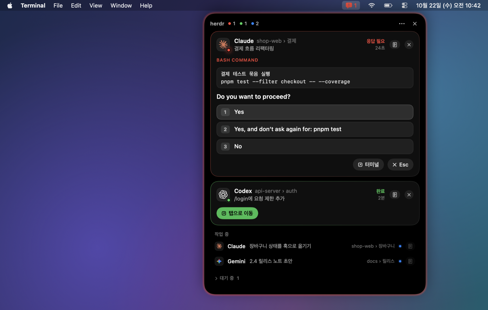
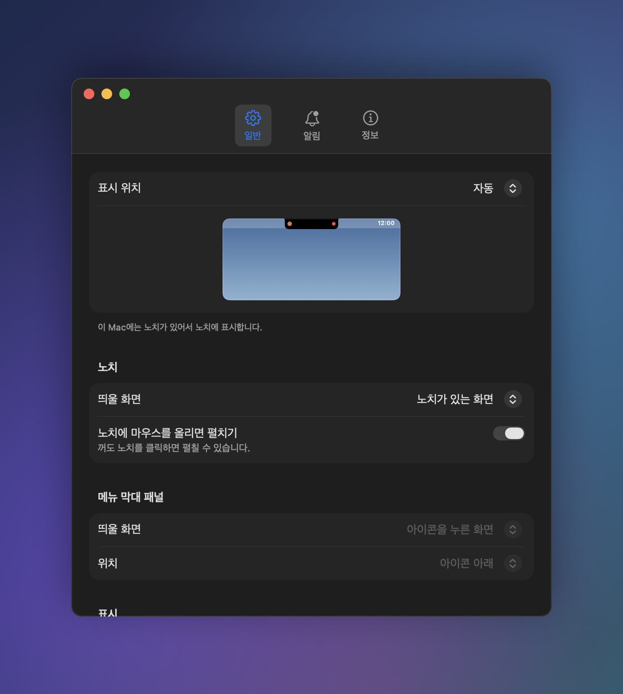

<div align="center">

[English](README.md) · **한국어**

# Herdr Island

**MacBook 노치에서 herdr 에이전트를 관리하세요.**

권한 승인, 질문 응답, 완료된 작업으로 이동, 진행 상황 확인까지 노치에서 바로 처리할 수 있습니다.
터미널을 오갈 필요가 없습니다.


<a href="docs/media/promo-ko.mp4"></a>

<sub>15초 · <a href="docs/media/promo-ko.mp4">고화질로 보기(MP4)</a></sub>

**노치에 마우스만 올리면 바로 열립니다.** 클릭도, 단축키도, 창 전환도 필요 없습니다.

</div>

---

## 왜 Herdr Island인가요?

[herdr](https://herdr.dev)로 에이전트를 여러 개 돌리다 보면 같은 일을 하루에도 수십 번 반복하게 됩니다.
승인을 기다리는 탭을 찾고, 그 터미널로 이동해 `1`을 누르고, 다시 하던 작업으로 돌아오는 일입니다.

Herdr Island는 이 과정을 노치로 가져옵니다. 에이전트가 응답을 기다리거나 작업을 마치면 노치가
Dynamic Island처럼 펼쳐지고, 그 자리에서 바로 응답할 수 있습니다. 노치가 없는 Mac에서는 메뉴바에서 같은 패널이 열립니다.

## 주요 기능

### 노치에 마우스를 올리면 바로 열림

마우스 포인터를 노치로 가져가면 0.1초 남짓 만에 아일랜드가 열리고, 포인터를 치우면 다시 접힙니다.
에이전트 상태를 확인하려고 하던 작업을 멈추거나 다른 앱으로 전환할 필요가 없습니다.
클릭으로 여는 쪽이 편하다면 설정에서 마우스 오버를 끄고 노치를 클릭해서 열 수도 있습니다.

### 권한 승인과 질문에 바로 응답

- **권한 요청**: 실행할 명령과 선택지(`Yes` / `Yes, and don't ask again…` / `No`)를 그대로 보여주고, 선택하면 에이전트에 바로 전달합니다.
- **질문(AskUserQuestion)**: 질문 탭, 선택지 설명, 다중 선택, 직접 입력, "대화로 답하기"를 지원합니다. 질문이 여러 개라면 다음 질문으로 이어서 진행합니다.
- **작업 완료**: **탭으로 이동**을 누르면 해당 herdr pane에 포커스가 옮겨지고 터미널 앱이 앞으로 나옵니다.
- 터미널에서 직접 응답해도 아일랜드가 화면을 다시 읽어 다음 단계에 맞춰 갱신됩니다.

<p align="center">
  
</p>

### 접힌 상태에서도 한눈에



접힌 노치 양옆에 대표 에이전트의 로고와 상태 표시가 나타납니다. 응답이 필요하면 아일랜드 가장자리가 **빨간색**으로,
완료된 작업이 있으면 **초록색**으로 은은하게 빛납니다(글로우). 쉬고 있던 세션에 Claude Code가 요약(recap)만
띄운 경우에는 **보라색**으로 빛나고 카드에 요약 내용이 나와서, 실제로 끝난 작업과 구분할 수 있습니다.
새 이벤트가 생기면 잠시 자동으로 펼쳐지고, 노치에 마우스를 올리거나 클릭하면 언제든 열 수 있습니다.

### 세션 상세: 토큰, 캐시, 도구, 파일

<table>
<tr>
<td width="44%"></td>
<td>

에이전트 옆의 상세 버튼을 누르면 아일랜드가 옆으로 넓어지면서 해당 세션의 상세 정보가 열립니다.

- **토큰**: 총사용량과 구성(캐시 읽기·캐시 쓰기·입력·출력)
- **캐시 히트율**과 **컨텍스트 크기**
- **작업 시간**, 턴 수, 세션 길이
- **활동**: 도구 호출 내역을 최신순으로 보여주고, 펼치면 입력과 결과를 확인할 수 있습니다
- **파일**: 수정한 파일의 diff(추가·삭제 줄 수 포함)와 읽은 파일 목록

</td>
</tr>
</table>

### 라이브 뷰: 지금 무엇을 하고 있는지



작업 중인 에이전트의 상세를 열면 **실시간** 탭이 먼저 표시됩니다. 현재 실행 중인 단계를 도구별 전용 화면으로
크게 보여주며, **크게 보기**를 누르면 아일랜드가 디스플레이 크기에 맞게 확장됩니다.

<table>
<tr>
<td width="50%"></td>
<td width="50%"></td>
</tr>
</table>

| 도구 | 표시 방식 |
| --- | --- |
| **Read** | 파일 전체를 띄우고, 읽은 범위를 강조한 뒤 해당 위치로 스크롤합니다. `.md` 파일은 렌더링된 문서로 보여줍니다. |
| **Write** | 에디터에 내용이 타이핑되듯 입력됩니다. |
| **Edit** | 실제 줄 번호가 붙은 diff를 보여주고, 추가된 줄이 타이핑되듯 입력됩니다. |
| **Bash** | 터미널 화면: 명령어, 경과 시간, 출력, 실패 여부 |
| **Grep / Glob** | 검색창과 결과 목록(매칭 부분 강조) |
| **WebFetch / WebSearch** | 브라우저 화면: 주소창, 로딩 바, 결과 |
| **Task** | 서브에이전트 카드와 진행 중인 하위 단계 |
| **TodoWrite** | 체크리스트와 진행률 바 |
| **Skill** | 스킬 배지 |

### 노치가 없다면: 메뉴바 모드



외장 모니터나 노치가 없는 Mac에서는 메뉴바 아이콘을 눌러 같은 패널을 열 수 있습니다.
노치와 메뉴바를 함께 쓰거나, 연결된 모든 디스플레이에 아일랜드를 띄울 수도 있습니다.

### macOS 네이티브 설정

<table>
<tr>
<td width="46%"></td>
<td>

일반적인 macOS 앱처럼 설정 창에서 변경할 수 있습니다. 변경 사항은 즉시 적용되고 `config.toml`에 저장됩니다.

- **표시 위치**: 노치, 메뉴바 또는 둘 다, 표시할 디스플레이
- **메뉴바 패널**: 표시할 디스플레이와 위치
- **알림**: 자동으로 펼칠지 여부, 유지 시간, 알림음
- **가장자리 빛**: 사용 여부, 색상, 밝기
- **투명도**: 마우스가 벗어나 있을 때 반투명하게 표시
- **닫기 동작**: 마우스가 벗어날 때, 바깥을 클릭할 때, 처리할 에이전트가 없을 때
- **언어**: 한국어 / English

</td>
</tr>
</table>

---

## 설치

**요구 사항**: macOS 13 이상 · [herdr](https://herdr.dev) 0.9.0 이상 · Xcode Command Line Tools(`xcode-select --install`)

```sh
herdr plugin install speardragon/herdr-island
```

소스에서 직접 설치하려면 저장소를 클론한 뒤 로컬 플러그인으로 연결합니다.

```sh
git clone https://github.com/speardragon/herdr-island.git
herdr plugin link ./herdr-island
```

설치 과정에서 Swift 헬퍼가 빌드되고, 다음 에이전트 이벤트부터 자동으로 실행됩니다. 별도로 실행할 필요는 없습니다.

## 사용법

| 작업 | 방법 |
| --- | --- |
| 아일랜드 열기 | 노치에 마우스를 올리거나 클릭. 메뉴바 모드에서는 아이콘 클릭 |
| 승인·질문에 응답 | 카드에서 선택지를 누르거나, 직접 입력한 뒤 Enter |
| 완료된 작업으로 이동 | 완료 카드의 **탭으로 이동** |
| 세션 상세 보기 | 카드나 목록 오른쪽의 상세 버튼 |
| 라이브 뷰 크게 보기 | 상세 상단의 **크게 보기**(↗) |
| 숨기기·닫기 | 카드의 ✕는 상태가 바뀔 때까지 숨기고, 아일랜드 오른쪽 위 ✕는 아일랜드를 닫습니다 |

### 단축키

herdr `config.toml`에 액션을 바인딩하면 단축키 하나로 열고 닫을 수 있습니다.

```toml
[[keys.command]]
key = "prefix+i"
type = "plugin_action"
command = "speardragon.herdr-island.toggle"
description = "Herdr Island"
```

| 액션 | 설명 |
| --- | --- |
| `toggle` / `open` / `close` | 아일랜드 열기·닫기 |
| `settings` | 설정 창 열기 |
| `mode-notch` / `mode-menubar` / `mode-both` / `cycle-mode` | 표시 위치 변경 |
| `reload` | `config.toml` 다시 불러오기 |
| `quit` | 종료(다음 에이전트 이벤트가 발생하면 다시 실행됨) |

```sh
herdr plugin action invoke speardragon.herdr-island.toggle
```

## 설정

설정 창(아일랜드의 `⋯` → **설정…**)에서 변경하는 것을 권장합니다. 파일을 직접 수정해도 됩니다.
설정 파일 위치는 `~/.config/herdr/plugins/config/speardragon.herdr-island/config.toml`입니다.

<details>
<summary><b>config.toml 전체 옵션</b></summary>

```toml
[display]
mode = "auto"              # auto | notch | menubar | both
screen = "notch"           # 아일랜드를 띄울 디스플레이: notch | main | mouse | all
hover_to_expand = true     # 노치에 마우스를 올리면 펼치기(클릭으로는 항상 열림)
show_working = true        # 작업 중인 에이전트 목록 표시
language = "system"        # system | en | ko
fade_when_idle = true      # 마우스가 벗어나 있으면 반투명하게
fade_after_seconds = 5
fade_opacity = 0.35        # 0.1 ~ 0.9

[menubar]
screen = "icon"            # icon(아이콘을 누른 디스플레이) | main | mouse | all
position = "icon"          # icon(아이콘 아래) | right(오른쪽 위) | center(가운데 위)

[behavior]
expand_on_blocked = true   # 응답이 필요하면 자동으로 펼치기
blocked_auto_close = true  # false면 자동으로 닫지 않음
blocked_peek_seconds = 9
expand_on_done = true
done_auto_close = true
done_peek_seconds = 6
close_on_leave = true      # 마우스가 벗어나면 닫기
leave_delay_seconds = 0.5
close_on_click_outside = true
close_when_clear = true    # 처리할 에이전트가 없으면 닫기(자동으로 펼쳐진 경우만)
blocked_sound = "none"     # "none" 또는 macOS 알림음 이름(Glass, Ping, Pop 등)
done_sound = "none"

[glow]
enabled = true             # 가장자리 빛
blocked_color = "FF453A"
done_color = "30D158"
recap_color = "BF5AF2"     # Claude Code가 요약(recap)만 띄운 완료
intensity = 0.6            # 0.1 ~ 1
```

파일을 수정한 뒤에는 `reload` 액션을 실행하세요.

</details>

## 지원 에이전트

| 에이전트 | 상태·알림 | 승인·질문 응답 | 세션 상세·라이브 뷰 |
| --- | :---: | :---: | :---: |
| Claude Code | ✅ | ✅ | ✅ |
| Codex | ✅ | 일부 지원(권한 승인) | ✅ (같은 폴더의 최근 세션으로 추정, 파일 추적은 `apply_patch`만 지원) |
| Gemini, Cursor, Copilot, OpenCode 등 herdr가 감지하는 에이전트 | ✅ | 터미널로 이동 | — |

## 동작 원리

```
herdr ──(소켓 events.subscribe)──▶ herdr-island 데몬 (Swift · AppKit + SwiftUI)
  ▲                                   │  blocked 화면 → 선택지 파싱
  └── agent.send_keys / send_text ◀───┘  버튼 클릭 → 키 입력
      agent.focus + 터미널 앱 활성화
                                      트랜스크립트(JSONL) ──▶ 세션 상세 · 라이브 뷰
```

- 이벤트마다 스크립트를 실행하는 대신, 상주 데몬 하나가 herdr 소켓 구독을 유지합니다. 플러그인 훅은 데몬이 실행 중인지만 확인합니다.
- 아일랜드는 포커스를 가져가지 않는 투명 패널입니다. 아일랜드가 그려진 영역만 클릭을 받고, 나머지 영역의 클릭은 아래 창으로 그대로 전달됩니다.
- 버튼을 누르는 시점에 터미널 화면을 다시 읽어 커서 위치에 맞는 키를 보냅니다. 따라서 커서가 직접 입력 칸에 있어도 응답이 정확히 전달됩니다.
- 세션 상세는 열려 있는 동안에만, 트랜스크립트에 새로 추가된 부분만 읽습니다.

### 개인정보

모든 처리는 로컬에서만 이루어집니다. Herdr Island는 herdr 소켓과 에이전트가 이미 남기고 있는 로컬 트랜스크립트
(`~/.claude/projects`, `~/.codex/sessions`)만 읽으며, 네트워크로 어떤 데이터도 전송하지 않습니다.

## FAQ

<details>
<summary><b>라이브 뷰는 정말 실시간인가요?</b></summary>

에이전트는 도구 호출이 끝난 뒤에 트랜스크립트를 기록합니다. 그래서 라이브 뷰는 0.5~1초가량 늦게 따라가며,
Write·Edit의 타이핑 효과는 완성된 내용을 최대 1.8초 동안 재생하는 연출입니다. 출력이나 파일 내용 같은 결과는 도구 실행이 끝난 뒤에 표시됩니다.

</details>

<details>
<summary><b>선택지 대신 "이 질문은 읽지 못했어요"라고 나옵니다.</b></summary>

아직 지원하지 않는 프롬프트 형식일 수 있습니다. 카드에 터미널 화면 마지막 부분이 함께 표시되니 내용을 확인할 수 있고,
**다시 읽기**로 재시도할 수 있습니다. 해당 화면은 `~/.local/state/herdr-island/unparsed-<pane>.txt`에 저장되니,
이슈에 첨부해 주시면 지원을 추가하겠습니다.

</details>

<details>
<summary><b>CPU는 얼마나 사용하나요?</b></summary>

평상시에는 거의 사용하지 않습니다. 응답이 필요하거나 완료된 에이전트가 있는 동안에는 가장자리 빛 애니메이션 때문에 몇 % 정도 사용하고,
라이브 뷰를 크게 띄워 둔 동안에는 조금 더 사용합니다. 가장자리 빛은 설정에서 끌 수 있습니다.

</details>

<details>
<summary><b>여러 디스플레이에 띄운 경우 하나를 닫으면 어떻게 되나요?</b></summary>

모두 함께 닫힙니다. 노치와 메뉴바를 함께 사용할 때도 마찬가지입니다.

</details>

## 개발

```sh
swiftc -O src/*.swift -o bin/herdr-island     # 빌드
./tests/run.sh                                # 테스트(파서, 설정, 트랜스크립트, 라이브 뷰 로직)
./bin/herdr-island --demo docs/images/ko ko   # README 스크린샷 생성(데모 데이터)
./bin/herdr-island --promo /tmp/promo ko      # 홍보 영상 프레임 생성(ffmpeg로 인코딩, docs/media 참고)
./bin/herdr-island --snapshot /tmp/island ko  # 현재 상태로 모든 화면을 PNG로 렌더링
./bin/herdr-island dump                       # 창 상태와 blocked 화면 덤프
./bin/herdr-island quit; sleep 1; ./bin/ensure-running.sh   # 다시 빌드한 뒤 재시작
```

데몬 로그는 `~/.local/state/herdr-island/daemon.log`에 기록됩니다.

## 크레딧

- 플러그인 구조와 터미널 활성화 로직은 [herdr-glow](https://github.com/DevooKim/herdr-glow)(MIT)를 참고했습니다.
- 프로바이더 로고: [LobeHub Icons](https://github.com/lobehub/lobe-icons)(MIT). 각 로고의 상표권은 해당 회사에 있습니다.
- 스크린샷에 나오는 에이전트, 프로젝트, 파일은 모두 데모용 가상 데이터입니다.

## 라이선스

[MIT](LICENSE)
