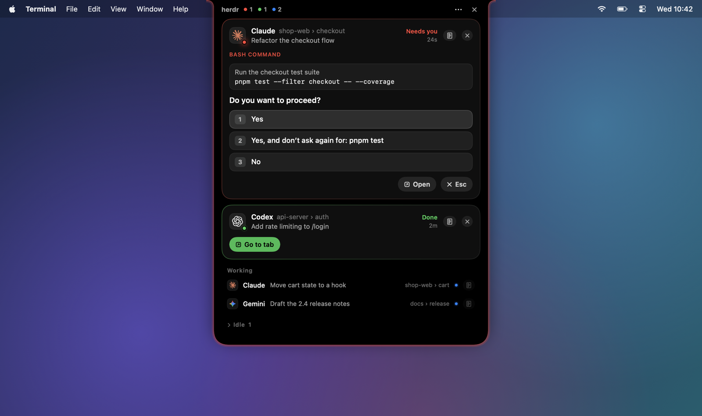
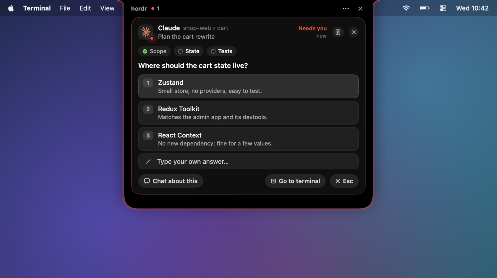
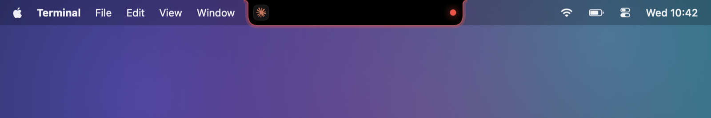
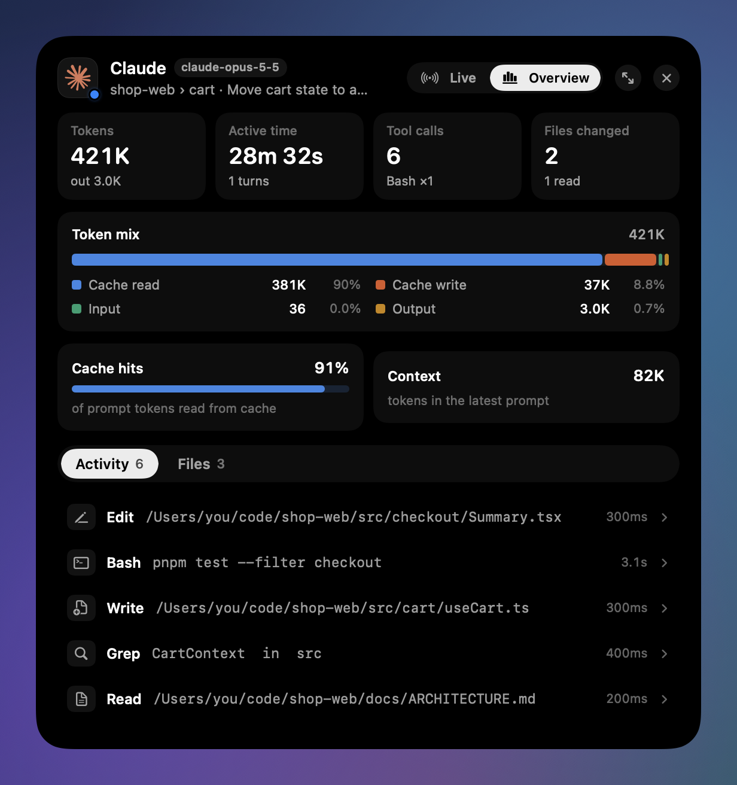
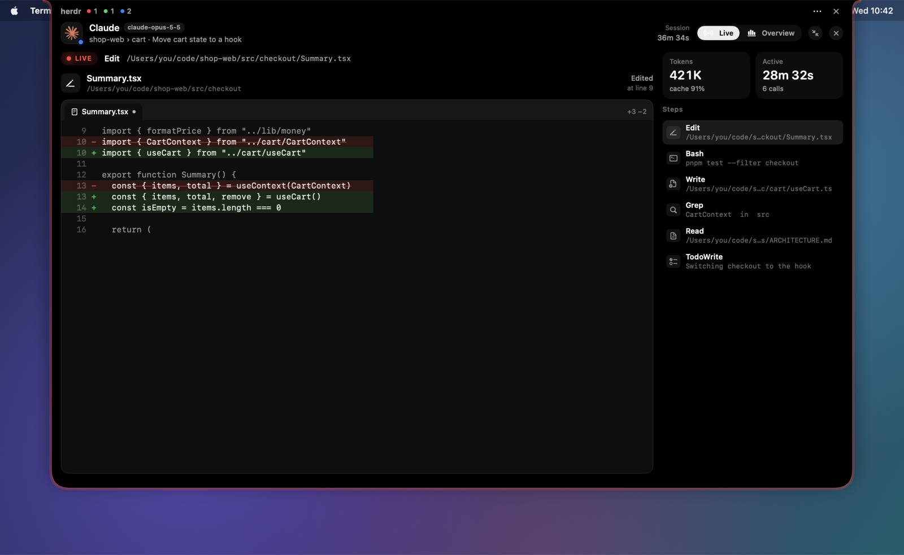
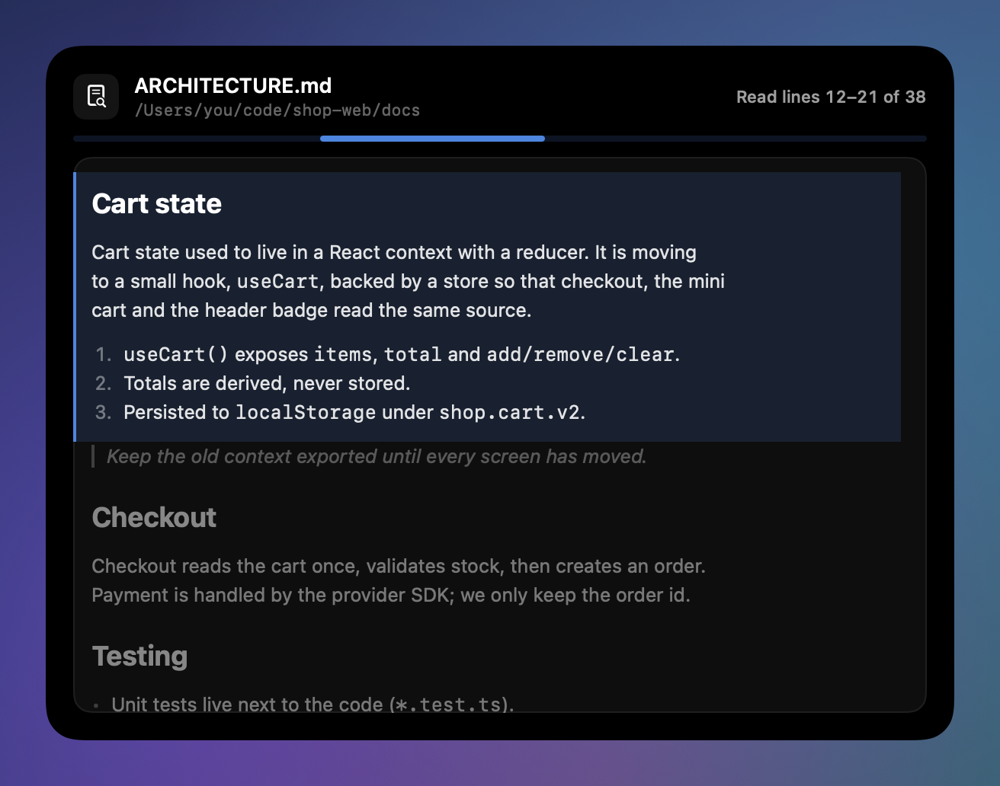
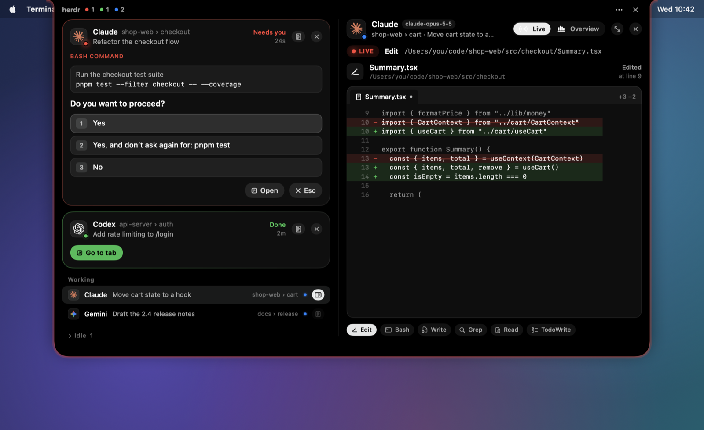
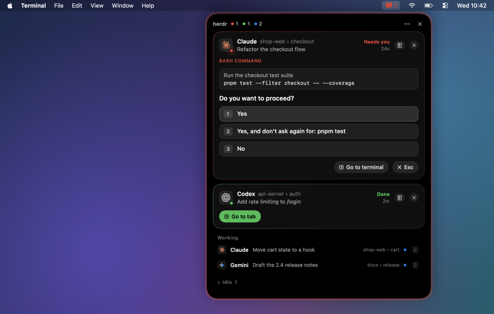
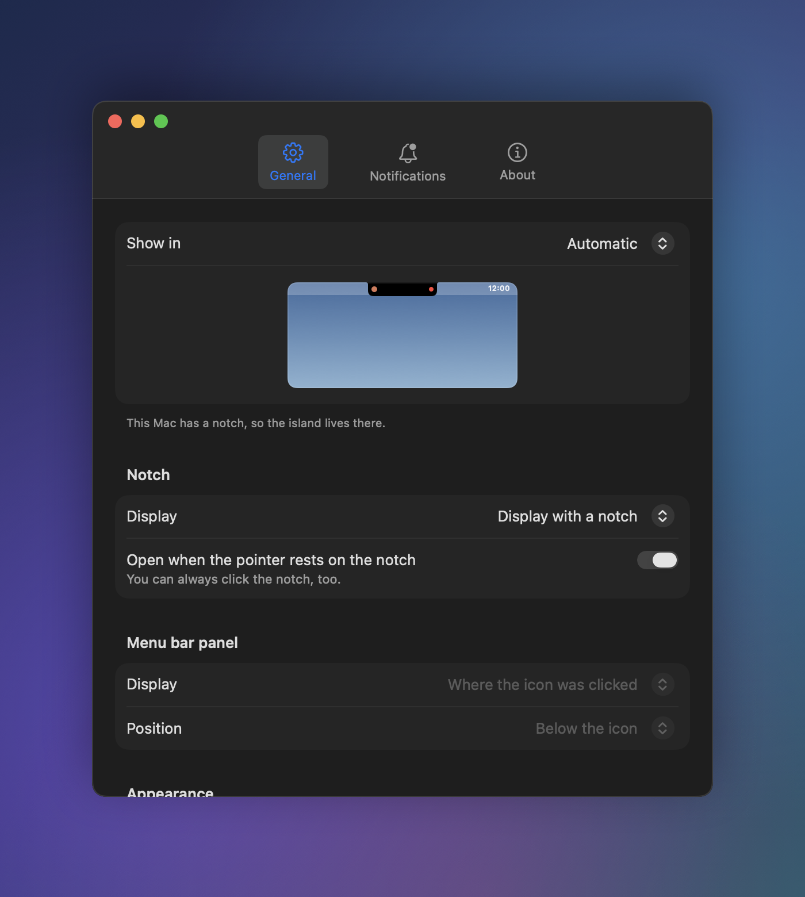

<div align="center">

**English** · [한국어](README.ko.md)

# Herdr Island

**Your herdr agents live in the MacBook notch.**

Approve a command, answer a question, jump to a finished task, and watch what an agent is doing right now,
without leaving what you are working on.




</div>

---

## Why Herdr Island?

Run a few agents in [herdr](https://herdr.dev) and the same chore comes up dozens of times a day:
find the tab that is waiting, switch to its terminal, press `1`, and switch back.

Herdr Island moves that chore into the notch. When an agent needs you or finishes, the notch opens
like a Dynamic Island and you answer it right there. On a Mac without a notch, the same panel drops from the menu bar.

## Features

### Answer permissions and questions in place

- **Permission prompts** show the command and its choices (`Yes` / `Yes, and don't ask again…` / `No`); a click sends that answer to the agent.
- **Questions (AskUserQuestion)**: question tabs, options with descriptions, multi-select checkboxes, your own answer, and "Chat about this". Multi-question prompts move on to the next question.
- **Finished agents**: **Go to tab** focuses the herdr pane and brings your terminal app forward.
- Answered something in the terminal instead? The island re-reads the screen and follows along.

<p align="center">
  
</p>

### Visible even when closed



The closed island shows the leading agent's mark and a status dot beside the notch. Its edge breathes
**red** while an agent waits for you and **green** when one has finished. New events open it for a moment;
hover or click the notch to open it any time.

### Session details: tokens, cache, tools, files

<table>
<tr>
<td width="44%"></td>
<td>

The details button beside an agent widens the island and opens that session.

- **Tokens**: the total and the mix (cache read, cache write, input, output)
- **Cache hit rate** and **context size**
- **Active time**, turns and session length
- **Activity**: every tool call, newest first; expand one for its input and result
- **Files**: changed files with +/− lines and diffs, and the files it read

</td>
</tr>
</table>

### Live stage: what it is doing right now



For a working agent, details open on the **Live** view: the current step, drawn the way that tool deserves.
**Bigger** grows the island to fit your display.

<table>
<tr>
<td width="50%"></td>
<td width="50%"></td>
</tr>
</table>

| Tool | How it is shown |
| --- | --- |
| **Read** | The whole file, with the lines being read lit up and scrolled into view. Markdown renders as a document. |
| **Write** | An editor with the new file typing itself in. |
| **Edit** | A diff with real line numbers; added lines type in. |
| **Bash** | A terminal: the command, elapsed time, output and failures |
| **Grep / Glob** | A search field and the hits, with matches highlighted |
| **WebFetch / WebSearch** | A browser: address bar, loading bar, the result |
| **Task** | A subagent card with its steps as they happen |
| **TodoWrite** | A checklist with progress |
| **Skill** | A skill badge |

### No notch? Use the menu bar



On external displays and Macs without a notch, the same panel opens from a menu bar icon.
Use the notch and the menu bar together, or put an island on every display.

### Settings that feel like macOS

<table>
<tr>
<td width="46%"></td>
<td>

A regular settings window, with changes applied at once and saved to `config.toml`:

- **Where it lives**: notch, menu bar or both, and which display
- **Menu bar panel**: which display and where it opens
- **Alerts**: when it opens by itself, for how long, and with what sound
- **Edge light**: on/off, colours and strength
- **Transparency** while the pointer is away
- **Closing**: on pointer leave, on outside click, when nothing needs you
- **Language**: English / 한국어

</td>
</tr>
</table>

---

## Install

**Requirements**: macOS 13 or later · [herdr](https://herdr.dev) 0.9.0 or later · Xcode Command Line Tools (`xcode-select --install`)

```sh
herdr plugin install speardragon/herdr-island
```

To run from source, clone the repository and link it as a local plugin:

```sh
git clone https://github.com/speardragon/herdr-island.git
herdr plugin link ./herdr-island
```

The Swift helper builds during install and starts with the next agent event. There is nothing else to launch.

## Usage

| To | Do |
| --- | --- |
| Open the island | Hover or click the notch; in menu bar mode, click the icon |
| Answer a prompt | Click an option, or type your own answer and press Return |
| Go to a finished task | **Go to tab** on its card |
| See session details | The details button on a card or row |
| Make the live stage bigger | **Bigger** (↗) at the top of the details |
| Hide things | ✕ on a card hides it until its status changes; ✕ top right closes the island |

### Keyboard shortcut

Bind an action in herdr's `config.toml` to open and close the island with one key:

```toml
[[keys.command]]
key = "prefix+i"
type = "plugin_action"
command = "speardragon.herdr-island.toggle"
description = "Herdr Island"
```

| Action | What it does |
| --- | --- |
| `toggle` / `open` / `close` | Open or close the island |
| `settings` | Open the settings window |
| `mode-notch` / `mode-menubar` / `mode-both` / `cycle-mode` | Change where it lives |
| `reload` | Re-read `config.toml` |
| `quit` | Quit (it starts again on the next agent event) |

```sh
herdr plugin action invoke speardragon.herdr-island.toggle
```

## Configuration

The settings window (`⋯` → **Settings…** in the island) is the easiest way. You can also edit
`~/.config/herdr/plugins/config/speardragon.herdr-island/config.toml` directly.

<details>
<summary><b>Every config.toml key</b></summary>

```toml
[display]
mode = "auto"              # auto | notch | menubar | both
screen = "notch"           # where the notch island goes: notch | main | mouse | all
hover_to_expand = true     # open when the pointer rests on the notch (clicking always works)
show_working = true        # list working agents
language = "system"        # system | en | ko
fade_when_idle = true      # turn see-through while the pointer is away
fade_after_seconds = 5
fade_opacity = 0.35        # 0.1 – 0.9

[menubar]
screen = "icon"            # icon (where it was clicked) | main | mouse | all
position = "icon"          # icon (below it) | right (top right) | center (top centre)

[behavior]
expand_on_blocked = true   # open by itself when an agent needs you
blocked_auto_close = true  # false keeps it open
blocked_peek_seconds = 9
expand_on_done = true
done_auto_close = true
done_peek_seconds = 6
close_on_leave = true      # close when the pointer leaves
leave_delay_seconds = 0.5
close_on_click_outside = true
close_when_clear = true    # close a self-opened island once nothing needs you
blocked_sound = "none"     # "none" or a macOS alert sound (Glass, Ping, Pop …)
done_sound = "none"

[glow]
enabled = true             # edge light
blocked_color = "FF453A"
done_color = "30D158"
intensity = 0.6            # 0.1 – 1
```

Run the `reload` action after editing the file.

</details>

## Supported agents

| Agent | Status & alerts | Answer prompts | Details & live stage |
| --- | :---: | :---: | :---: |
| Claude Code | ✅ | ✅ | ✅ |
| Codex | ✅ | Partial (approval prompts) | ✅ (matched to the newest session in the same folder; files via `apply_patch` only) |
| Gemini, Cursor, Copilot, OpenCode and other agents herdr detects | ✅ | Jump to the terminal | — |

## How it works

```
herdr ──(socket events.subscribe)──▶ herdr-island daemon (Swift · AppKit + SwiftUI)
  ▲                                     │  blocked screen → parsed options
  └── agent.send_keys / send_text ◀─────┘  button → key presses
      agent.focus + terminal activation
                                        session transcript (JSONL) ──▶ details · live stage
```

- One resident daemon keeps a herdr socket subscription instead of starting a script per event; the plugin hook only makes sure it is running.
- The island is a transparent panel that never takes focus. It accepts clicks only on the drawn island; everything else passes through to the window below.
- When you click, it reads the terminal again and picks the keys for wherever the cursor is, so answers land correctly even if the cursor sits in the free-text field.
- Session details read only what was appended to the transcript, and only while the details are open.

### Privacy

Everything stays on your Mac. Herdr Island reads the herdr socket and the transcripts your agents already
write (`~/.claude/projects`, `~/.codex/sessions`), and sends nothing over the network.

## FAQ

<details>
<summary><b>Is "live" really live?</b></summary>

Agents write a tool call to their transcript once it is complete, so the stage follows 0.5–1 s behind,
and the typing in Write/Edit is a playback of the finished text (at most 1.8 s). Results such as output
or file contents arrive when the tool finishes.

</details>

<details>
<summary><b>I see "Couldn't read this prompt" instead of buttons.</b></summary>

It is probably a prompt format the parser has not seen. The card shows the bottom of the terminal so you can
still read it, and **Read again** retries. The screen is saved to `~/.local/state/herdr-island/unparsed-<pane>.txt`;
attach it to an issue and the format can be added.

</details>

<details>
<summary><b>How much CPU does it use?</b></summary>

Almost none when nothing is going on. While an agent waits or has finished, the edge-light animation uses a few
percent, and a full-size live stage uses more while it is open. The edge light can be turned off in settings.

</details>

<details>
<summary><b>With an island on every display, what does closing one do?</b></summary>

It closes all of them, and the same goes for notch + menu bar.

</details>

## Development

```sh
swiftc -O src/*.swift -o bin/herdr-island     # build
./tests/run.sh                                # tests (parser, config, transcripts, live-stage logic)
./bin/herdr-island --demo docs/images/en en   # README screenshots (made-up data)
./bin/herdr-island --snapshot /tmp/island en  # every view as PNG, from live state
./bin/herdr-island dump                       # window state and blocked screens
./bin/herdr-island quit; sleep 1; ./bin/ensure-running.sh   # restart after a rebuild
```

The daemon logs to `~/.local/state/herdr-island/daemon.log`.

## Credits

- Plugin structure and terminal activation follow [herdr-glow](https://github.com/DevooKim/herdr-glow) (MIT).
- Provider marks: [LobeHub Icons](https://github.com/lobehub/lobe-icons) (MIT). Each mark is a trademark of its owner.
- Agents, projects and files in the screenshots are made-up demo data.

## License

[MIT](LICENSE)
